# XGBA — permanent verified evidence gallery

Native emulator screenshot/GIF files here are unmodified bytes from passing exact-head CI.
No AI mockups or host-made replacement scenes. Large emulator-console JSON logs
are omitted from compact verification summaries, with their source hashes preserved.
No executable ROMs, sidecars, save files or raw proprietary game assets are archived.
Screenshots contain game imagery belonging to its rights holders and are shown
only as limited, noncommercial engineering documentation.

## R26 — verified original Emerald scoped arena leases (Actions evidence)

[Exact-head native R26 CI #43072910123](https://github.com/xbaconator9000x/XGBA-ROM-Expansion/actions/runs/43072910123) passed **17/17 original Emerald tests** at `93aa67d9e75792cc5a2100379f2668e9bbc1f3e2`. The original game performed four battles, three field restorations and scoped borrows across eight external maps and eight external opponent sources. Sixteen attempted unsafe phase switches were refused; no borrowed pins remained.

[Eight genuine original LCD screenshots and machine-readable proof (Actions ZIP)](https://github.com/xbaconator9000x/XGBA-ROM-Expansion/actions/runs/43072910123/artifacts/13880215862) · [Merged PR #81](https://github.com/xbaconator9000x/XGBA-ROM-Expansion/pull/81) · [Detailed R26 technical evidence](../docs/R26_EWRAM_LEASES.md).

**Retention:** R26's ZIP is time-limited and its PNGs have **not** been committed into this permanent gallery; this link is the actual CI artifact, not a substituted mockup. R26 does not establish the lifetime of arbitrary renderer DMA or three-map eviction.

## R25 — verified original FireRed AND Emerald game-armed DMA3 lifetime protection

Both original ARM games independently passed **15/15 native tests** (2026-11-12)
at source head `5d729f9af4ab338e44dbae1834643befba692186`.
The original guest arms a deferred VBlank DMA3 reader of an external-resource
EWRAM buffer, receives explicit **DMA_BUSY=6** when requesting an overlapping
external write, verifies unchanged buffer/guard bytes, disarms DMA and
successfully reloads the resource. This is not a claim of mid-beat DMA
interruption. The production device separately passed 19 portable DMA
footprint/mirroring cases. The native R24 FireRed and Emerald suites and
three-job consolidated memory/Flash/battle regressions also passed.

- [Native FireRed 15/15, Emerald 15/15 and original 240×160 LCD evidence](https://github.com/xbaconator9000x/XGBA-ROM-Expansion/actions/runs/43067407151)
- [Original FireRed R25 PNGs and proof.json, artifact #13876512589](https://github.com/xbaconator9000x/XGBA-ROM-Expansion/actions/runs/43067407151/artifacts/13876512589)
- [Original Emerald R25 PNGs and proof.json, artifact #13876851400](https://github.com/xbaconator9000x/XGBA-ROM-Expansion/actions/runs/43067407151/artifacts/13876851400)
- [Production device 19-case suite](https://github.com/xbaconator9000x/XGBA-ROM-Expansion/actions/runs/43067407140) · [R25 source PR #80](https://github.com/xbaconator9000x/XGBA-ROM-Expansion/pull/80)

The linked R25 ZIP artifacts are time-limited GitHub Actions evidence. They
have **not yet** been archived under `evidence/verified/r25-*`; do not
mistake these CI links for permanent file-by-file SHA-256 provenance.

## R24 — original FireRed AND Emerald exact 16 KiB MMIO boundaries

**Both original games independently pass 14/14 native tests.** Pinned
source-built FireRed and Emerald perform nine game-issued XGBA MMIO
transactions: two successful full 16 KiB external resource loads,
seven distinct malformed requests rejected without writing any guest
destination byte, redzone guard validation and a successful recovery.
Source bytes and SHA-256 were independently verified. Disabled runs
use identical ROMs and produce zero external-resource provider reads.
An additional unit suite exercises 256 malformed memory ranges.

| FireRed original-game resource enabled | FireRed identical-ROM XGBA disabled |
| --- | --- |
| [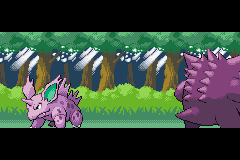](verified/r24-firered/firered-boundary-enabled.png) | [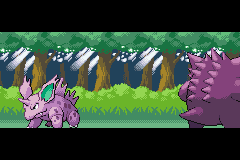](verified/r24-firered/firered-boundary-disabled.png) |

| Emerald original-game resource enabled | Emerald identical-ROM XGBA disabled |
| --- | --- |
|  | [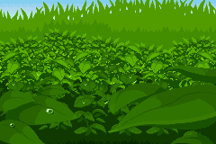](verified/r24-emerald/emerald-boundary-disabled.png) |

[Original FireRed native 14/14](https://github.com/xbaconator9000x/XGBA-ROM-Expansion/actions/runs/43051443138) · [FireRed SHA provenance](verified/r24-firered/provenance.json) · [FireRed proof](verified/r24-firered/proof.json) · [Original Emerald native 14/14](https://github.com/xbaconator9000x/XGBA-ROM-Expansion/actions/runs/43051443181) · [Emerald SHA provenance](verified/r24-emerald/provenance.json) · [Emerald proof](verified/r24-emerald/proof.json) · [R24 merged source PR #78](https://github.com/xbaconator9000x/XGBA-ROM-Expansion/pull/78)

**Limits:** No in-flight DMA buffer-lifetime proof, three-connected-map
eviction, stock emulator or original GBA hardware.

## R23 — four original Emerald battles and forced EWRAM phase eviction

R23 passed 12/12 exact-head native original Emerald tests. Overworld
Littleroot and Route 101 map packs and two original compressed enemy
front sprites replace each other in the same bounded 16KiB physical
EWRAM arena. Three returns to original field reacquire both maps
before BG VRAM initialization; four battles fetch fresh fronts.
Four allocator pressure cycles confirm 16 original allocations/frees,
four oversized refusals and 24,576 verified live guard bytes.
This is real phase eviction, not three-connected-map eviction.

| First externally backed field | First source-backed real battle |
| --- | --- |
|  | [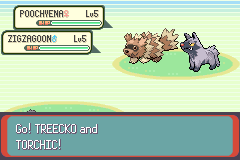](verified/r23/02-original-emerald-local-plus-two-external-opponents.png) |

| First field restoration | Second source-backed battle |
| --- | --- |
|  |  |

| Second field restoration | Third source-backed battle |
| --- | --- |
| [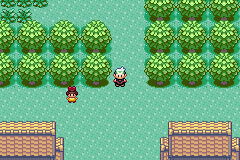](verified/r23/r23-05-original-emerald-fully-recovered-external-field.png) | [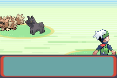](verified/r23/r23-06-original-emerald-two-reacquired-external-opponents.png) |

| Third field restoration | Fourth source-backed battle |
| --- | --- |
|  |  |

[R23 exact-head native CI 12/12](https://github.com/xbaconator9000x/XGBA-ROM-Expansion/actions/runs/43028611280) · [SHA provenance](verified/r23/provenance.json) · [proof](verified/r23/proof.json) · [source PR #75](https://github.com/xbaconator9000x/XGBA-ROM-Expansion/pull/75)

**Limits:** Battle-vs-map working-set eviction only, not arbitrary
third connected map, in-flight DMA, variable-size pack paging or
original stock GBA/mGBA compatibility.

## R22 — 102 original Emerald D-pad connected-map crossings

R22 passed 7/7 native tests with original Emerald game and pinned mGBA.
The game crossed Littleroot Town and Route 101 boundaries 102 times,
with 103 independent source-backed map/BG VRAM verification points.
Both external packs stayed simultaneously resident without unwanted
reloads, EWRAM arena generation changes or provider failures.
This is two-map RETENTION / CHURN, not a forced eviction test.

| Initial external Littleroot | Route 101 original camera crossing | Returned to Littleroot |
| --- | --- | --- |
|  |  | [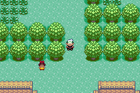](verified/r22/03-return-littleroot-live-packs.png) |

| 2 extra crossings | 52 extra crossings | 100 extra crossings |
| --- | --- | --- |
|  | [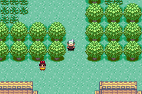](verified/r22/r22-crossings-052-stable-externally-backed-field.png) |  |

[R22 passing exact-head native CI 7/7](https://github.com/xbaconator9000x/XGBA-ROM-Expansion/actions/runs/43026113878) · [SHA provenance](verified/r22/provenance.json) · [proof](verified/r22/proof.json) · [source PR #73](https://github.com/xbaconator9000x/XGBA-ROM-Expansion/pull/73)

**Limits:** two original simultaneous map packs, not 3+ map
evictions, full allocator leak certification, DMA races, hardware
or unmodified emulator compatibility.

## R21 — actual Emerald allocator pressure across two original battles

R21 passed 10/10 exact-head native tests against original source-built
Emerald and native mGBA. The guest's real MemBlock allocator performs
two 12 KiB fragmentation pressure cycles using Alloc/Free/CheckHeap,
checks 12,288 adjacent live guard bytes and rejects two impossible
oversized allocations. Peak observed live heap allocation: 24,896 bytes.
The linker-audited 16 KiB external-resource tail remains outside the
original allocator throughout two source-backed battle encounters.

| Before heap pressure and first battle | First source-backed battle |
| --- | --- |
|  |  |

| Recovered external overworld | Second battle after heap pressure |
| --- | --- |
|  |  |

[R21 exact-head native CI 10/10](https://github.com/xbaconator9000x/XGBA-ROM-Expansion/actions/runs/43023656373) · [R20 reentry regression](https://github.com/xbaconator9000x/XGBA-ROM-Expansion/actions/runs/43023656014) · [R19 connected map regression](https://github.com/xbaconator9000x/XGBA-ROM-Expansion/actions/runs/43023656317) · [provenance](verified/r21/provenance.json) · [source PR #71](https://github.com/xbaconator9000x/XGBA-ROM-Expansion/pull/71)

**Limits:** small reproducible allocator pressure, not arbitrary heap
exhaustion, DMA hazards, hundreds of transitions, dynamic reserved
tail release, stock emulator support or original GBA hardware.

## R20 — Emerald bounded EWRAM arena survives battle → map → battle

Native 6/6 at exact implementation head 448bb54c. Original source-built
Emerald executes two real double battles separated by a return to its
externally backed overworld. Two source-stripped connected map packs are
reacquired before the original BG renderer initializes; original external
opponent sprites are fetched and decompressed again during the second battle.
Evidence: four genuinely rendered 240×160 native Emerald LCD frames.

| Original external-map overworld | First genuine mixed-source battle |
| --- | --- |
|  |  |

| Reacquired externally backed field | Second genuine mixed-source battle |
| --- | --- |
|  |  |

[R20 exact-head native CI 6/6](https://github.com/xbaconator9000x/XGBA-ROM-Expansion/actions/runs/43020066026) · [R19 battle regression](https://github.com/xbaconator9000x/XGBA-ROM-Expansion/actions/runs/43020065894) · [R19 map regression](https://github.com/xbaconator9000x/XGBA-ROM-Expansion/actions/runs/43020065937) · [provenance](verified/r20/provenance.json) · [source PR #69](https://github.com/xbaconator9000x/XGBA-ROM-Expansion/pull/69)

**Scope:** two battle cycles and verified phase reuse; NOT exhaustive EWRAM
fragmentation stress, canary/DMA coverage, user-facing error handling,
general unlimited scene streaming, stock mGBA or original GBA hardware.

## R19 — original Emerald connected maps and mixed-storage Pokémon battles

Both native integration suites passed 6/6 tests each at the same commit:
two complete original Emerald maps and secondary tilesets physically traversed,
and a genuine double wild battle using vanilla-ROM Treecko/Torchic plus
Poochyena/Zigzagoon front sprites from different external addresses.
The source-built game, not the host, executed the graphics decompression.
All five original Emerald LCD frames below preserve their CI bytes.

### Real connected maps: Littleroot Town ↔ Route 101

| Littleroot native external | Route 101 native external | Returned to Littleroot |
| --- | --- | --- |
| [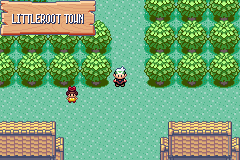](verified/r19-maps/01-original-littleroot-two-maps-loaded.png) | [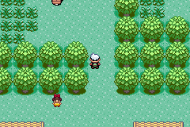](verified/r19-maps/02-real-route101-external-crossing.png) |  |

[R19 maps exact-head native CI 6/6](https://github.com/xbaconator9000x/XGBA-ROM-Expansion/actions/runs/43006516293) · [SHA provenance](verified/r19-maps/provenance.json) · [proof](verified/r19-maps/proof.json)

### Real mixed-source Emerald double wild battle

| Original external-map overworld | Original Emerald battle with ROM + external sprites |
| --- | --- |
|  |  |

[R19 battle exact-head native CI 6/6](https://github.com/xbaconator9000x/XGBA-ROM-Expansion/actions/runs/43006516094) · [SHA provenance](verified/r19-battle/provenance.json) · [proof](verified/r19-battle/proof.json) · [implementation draft PR #67](https://github.com/xbaconator9000x/XGBA-ROM-Expansion/pull/67)

**Limits:** battle graphics are original front/back sprites: external move
animations, arbitrary multi-file sidecars, trillion-byte logical storage
offsets, production UI and original hardware are not yet verified.

## R18 — original Emerald Flash save, cold continuation and reloaded external map

The pinned source-built original Emerald saved to genuine Flash, exited mGBA,
and a fresh process continued from the real save in externally backed Littleroot.
A third process verified corrupt-resource refusal without altering the good save.
Five exact-head native tests passed, including original CPU/EWRAM/BG VRAM checks.

| Original Emerald before Flash save | After Flash sector write | Cold-reloaded Littleroot |
| --- | --- | --- |
| [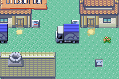](verified/r18/01-original-emerald-before-flash.png) | [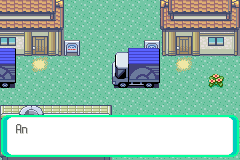](verified/r18/02-original-emerald-after-flash-write.png) |  |

[R18 native CI 5/5](https://github.com/xbaconator9000x/XGBA-ROM-Expansion/actions/runs/42995836013) · [source PR #65](https://github.com/xbaconator9000x/XGBA-ROM-Expansion/pull/65) · [SHA-verified provenance](verified/r18/provenance.json) · [proof](verified/r18/proof.json)

**Limits:** actual Emerald Flash was invoked by a test-only SELECT shortcut; this
does not yet demonstrate the graphical Start→Save menu, arbitrary maps,
battle assets, stock mGBA or a production-friendly pack-mismatch UI.

## R17 — real Emerald Littleroot map and complete secondary tileset from external storage

The actual source-built Emerald game had its native Littleroot map grid and border,
Petalburg secondary graphics/palettes/metatiles/attributes stripped from the ROM.
The engine fetched the original bytes from beyond 32 MiB, verified its map grid
and native background VRAM, and moved the player by physical D-pad input.
Six genuine native acceptance tests passed at exact head, also independently in PR CI.

| Original Emerald with external Littleroot map | Same native game after real D-pad |
| --- | --- |
|  |  |

[Passing R17 native push CI 6/6](https://github.com/xbaconator9000x/XGBA-ROM-Expansion/actions/runs/42993487976) · [matching exact-head PR CI](https://github.com/xbaconator9000x/XGBA-ROM-Expansion/actions/runs/42993559059) · [source PR #64](https://github.com/xbaconator9000x/XGBA-ROM-Expansion/pull/64) · [SHA-verified provenance](verified/r17/provenance.json) · [proof](verified/r17/proof.json)

**Limits:** this is one original Emerald external town map and its secondary tileset,
with test-only title/truck-sequence bypass. General map transitions and Emerald
Flash save/cold restart are not part of R17.

## R16 — original Pokémon Emerald decomp executes XGBA's existing native provider

Pinned source-built pokeemerald (MODERN=1) issues the same XGBA MMIO resource request
used by FireRed, receives and verifies bytes in the physical GBA's EWRAM, and
continues executing its original game loop. Disabled mode made zero external reads.
This proves engine/guest-ABI portability, **not** Emerald external map, save or battle support.

| Emerald with sidecar enabled | Same Emerald ROM, extension disabled |
| --- | --- |
|  |  |

[R16 exact-head native CI 5/5](https://github.com/xbaconator9000x/XGBA-ROM-Expansion/actions/runs/42990445836) · [R16 source PR #62](https://github.com/xbaconator9000x/XGBA-ROM-Expansion/pull/62) · [Provenance](verified/r16/provenance.json) · [Compact proof](verified/r16/proof.json)

## R15 — original FireRed Flash save, cold reboot, and reloaded external house

These are four genuine 240×160 screenshots from two separate native mGBA processes.
FireRed wrote its own Flash sectors, mGBA exited, and a fresh process loaded the saved game.
A third independent process proved corruption refusal without modifying the valid save.

| House before save | After original Flash write | Identical house after cold restart | Return to Pallet |
| --- | --- | --- | --- |
|  |  |  |  |

**The original house-before-save and cold-boot screenshots have identical SHA-256 pixel-file bytes.**
[Passing R15 native CI, 4/4](https://github.com/xbaconator9000x/XGBA-ROM-Expansion/actions/runs/42987149871) · [R15 exact-head source PR #60](https://github.com/xbaconator9000x/XGBA-ROM-Expansion/pull/60) · [Provenance](verified/r15/provenance.json) · [Compact proof](verified/r15/proof.json)

Scope: this is the original FireRed Flash engine and cold-game-continue routine,
not the visual Start → Save menu. The deliberately corrupted pack fails closed
inside the bounded test fixture; a user-facing recovery screen remains future work.

## R14 — external tilesets, actual house door and connected Route 1

| Pallet Town | Player's house | House exit | Route 1 |
| --- | --- | --- | --- |
|  |  |  |  |

[Original R14 4/4 native CI](https://github.com/xbaconator9000x/XGBA-ROM-Expansion/actions/runs/42977112057) · 
[Provenance](verified/r14/provenance.json) · [Proof summary](verified/r14/proof.json)

## R13 — the original house layout beyond 32 MiB

| Externally loaded house | Returned to Pallet | Re-entered house | Disabled-mode control |
| --- | --- | --- | --- |
|  |  |  |  |

[Original R13 4/4 native CI](https://github.com/xbaconator9000x/XGBA-ROM-Expansion/actions/runs/42966044589) · [Provenance](verified/r13/provenance.json)

## R12 — real save-state restoration and external resource reacquisition

| Before SELECT | After SELECT | Native restore | Reacquisition |
| --- | --- | --- | --- |
|  |  |  |  |

[Original R12 4/4 native CI](https://github.com/xbaconator9000x/XGBA-ROM-Expansion/actions/runs/42964008063) · [Provenance](verified/r12/provenance.json)

## R11 — measured native FireRed CPU-frame throughput (not GUI FPS)

[Complete measured benchmark summary](verified/r11/r11-summary.json) · [Frame timings CSV](verified/r11/r11-frame-timings.csv) · 
[Original native CI](https://github.com/xbaconator9000x/XGBA-ROM-Expansion/actions/runs/42959825105)

## R10 — live native FireRed Pallet Town sprite swap

[Original R10 CI](https://github.com/xbaconator9000x/XGBA-ROM-Expansion/actions/runs/42955838562) · [Comparison](verified/r10/pallet-town-real-engine-comparison.png)

## R9 — same ROM, two different external graphics packs

| Crystal | Magma | Disabled fallback |
| --- | --- | --- |
|  |  |  |

[Original R9 native CI](https://github.com/xbaconator9000x/XGBA-ROM-Expansion/actions/runs/42950960274) · [Three-run comparison](verified/r9/r9-three-runs-comparison.png)

## Permanent integrity and attribution

For every milestone, its provenance.json links to the passing source workflow
and the exact executable commit, and records the original artifact SHA-256
and per-file hashes. Original screenshots and GIFs are byte-for-byte preserved.
Compact proof summaries are clearly marked by unaltered=false and retain
the original document SHA-256. Repository history preserves these selected
documentation assets even after GitHub Actions download links expire.
