# XGBA — permanent verified evidence gallery

Native emulator screenshot/GIF files here are unmodified bytes from passing exact-head CI.
No AI mockups or host-made replacement scenes. Large emulator-console JSON logs
are omitted from compact verification summaries, with their source hashes preserved.
No executable ROMs, sidecars, save files or raw proprietary game assets are archived.
Screenshots contain game imagery belonging to its rights holders and are shown
only as limited, noncommercial engineering documentation.

## R17 — real Emerald Littleroot map and complete secondary tileset from external storage

The actual source-built Emerald game had its native Littleroot map grid and border,
Petalburg secondary graphics/palettes/metatiles/attributes stripped from the ROM.
The engine fetched the original bytes from beyond 32 MiB, verified its map grid
and native background VRAM, and moved the player by physical D-pad input.
Six genuine native acceptance tests passed at exact head, also independently in PR CI.

| Original Emerald with external Littleroot map | Same native game after real D-pad |
| --- | --- |
| [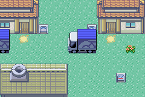](verified/r17/01-littleroot-real-external-map.png) | [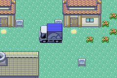](verified/r17/02-littleroot-after-real-dpad.png) |

[Passing R17 native push CI 6/6](https://github.com/xbaconator9000x/XGBA-ROM-Expansion/actions/runs/42993487976) · [matching exact-head PR CI](https://github.com/xbaconator9000x/XGBA-ROM-Expansion/actions/runs/42993559059) · [source PR #64](https://github.com/xbaconator9000x/XGBA-ROM-Expansion/pull/64) · [SHA-verified provenance](verified/r17/provenance.json) · [proof](verified/r17/proof.json)

**Limits:** this is one original Emerald external town map and its secondary tileset,
with test-only title/truck-sequence bypass. General map transitions and Emerald
Flash save/cold restart are not part of R17.

## R16 — original Pokémon Emerald decomp executes XGBA's existing native provider

Pinned source-built pokeemerald (MODERN=1) issues the same XGBA MMIO resource request
used by FireRed, receives and verifies bytes in the physical GBA's EWRAM, and
continues executing its original game loop. Disabled mode made zero external reads.
This proves engine/guest-ABI portability, **not** Emerald external map, save or battle support.

| Emerald with sidecar enabled | Same Emerald ROM, extension disabled |
| --- | --- |
|  |  |

[R16 exact-head native CI 5/5](https://github.com/xbaconator9000x/XGBA-ROM-Expansion/actions/runs/42990445836) · [R16 source PR #62](https://github.com/xbaconator9000x/XGBA-ROM-Expansion/pull/62) · [Provenance](verified/r16/provenance.json) · [Compact proof](verified/r16/proof.json)

## R15 — original FireRed Flash save, cold reboot, and reloaded external house

These are four genuine 240×160 screenshots from two separate native mGBA processes.
FireRed wrote its own Flash sectors, mGBA exited, and a fresh process loaded the saved game.
A third independent process proved corruption refusal without modifying the valid save.

| House before save | After original Flash write | Identical house after cold restart | Return to Pallet |
| --- | --- | --- | --- |
|  | [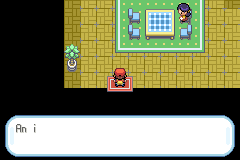](verified/r15/02-house-after-flash-save.png) | [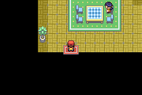](verified/r15/03-cold-boot-house-reloaded.png) | [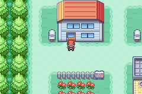](verified/r15/04-after-cold-boot-pallet.png) |

**The original house-before-save and cold-boot screenshots have identical SHA-256 pixel-file bytes.**
[Passing R15 native CI, 4/4](https://github.com/xbaconator9000x/XGBA-ROM-Expansion/actions/runs/42987149871) · [R15 exact-head source PR #60](https://github.com/xbaconator9000x/XGBA-ROM-Expansion/pull/60) · [Provenance](verified/r15/provenance.json) · [Compact proof](verified/r15/proof.json)

Scope: this is the original FireRed Flash engine and cold-game-continue routine,
not the visual Start → Save menu. The deliberately corrupted pack fails closed
inside the bounded test fixture; a user-facing recovery screen remains future work.

## R14 — external tilesets, actual house door and connected Route 1

| Pallet Town | Player's house | House exit | Route 1 |
| --- | --- | --- | --- |
| [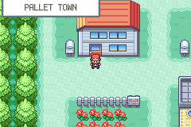](verified/r14/01-pallet-external-tiles.png) |  |  | [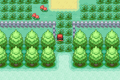](verified/r14/04-route1-connected-external.png) |

[Original R14 4/4 native CI](https://github.com/xbaconator9000x/XGBA-ROM-Expansion/actions/runs/42977112057) · 
[Provenance](verified/r14/provenance.json) · [Proof summary](verified/r14/proof.json)

## R13 — the original house layout beyond 32 MiB

| Externally loaded house | Returned to Pallet | Re-entered house | Disabled-mode control |
| --- | --- | --- | --- |
| [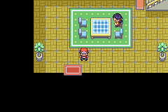](verified/r13/enabled/02-house-external.png) |  |  | [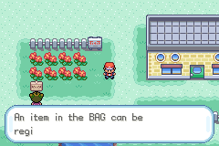](verified/r13/disabled/02-entry-refused.png) |

[Original R13 4/4 native CI](https://github.com/xbaconator9000x/XGBA-ROM-Expansion/actions/runs/42966044589) · [Provenance](verified/r13/provenance.json)

## R12 — real save-state restoration and external resource reacquisition

| Before SELECT | After SELECT | Native restore | Reacquisition |
| --- | --- | --- | --- |
|  | [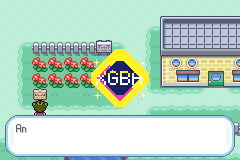](verified/r12/enabled/02-after-select.png) | [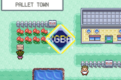](verified/r12/enabled/03-restored.png) |  |

[Original R12 4/4 native CI](https://github.com/xbaconator9000x/XGBA-ROM-Expansion/actions/runs/42964008063) · [Provenance](verified/r12/provenance.json)

## R11 — measured native FireRed CPU-frame throughput (not GUI FPS)

[Complete measured benchmark summary](verified/r11/r11-summary.json) · [Frame timings CSV](verified/r11/r11-frame-timings.csv) · 
[Original native CI](https://github.com/xbaconator9000x/XGBA-ROM-Expansion/actions/runs/42959825105)

## R10 — live native FireRed Pallet Town sprite swap

[Original R10 CI](https://github.com/xbaconator9000x/XGBA-ROM-Expansion/actions/runs/42955838562) · [Comparison](verified/r10/pallet-town-real-engine-comparison.png)

## R9 — same ROM, two different external graphics packs

| Crystal | Magma | Disabled fallback |
| --- | --- | --- |
| [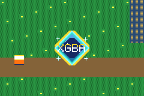](verified/r9/crystal-real-mgba.gif) | [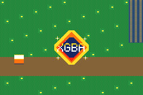](verified/r9/magma-real-mgba.gif) | [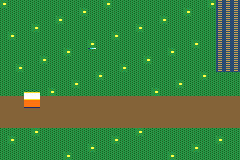](verified/r9/fallback-real-mgba.gif) |

[Original R9 native CI](https://github.com/xbaconator9000x/XGBA-ROM-Expansion/actions/runs/42950960274) · [Three-run comparison](verified/r9/r9-three-runs-comparison.png)

## Permanent integrity and attribution

For every milestone, its provenance.json links to the passing source workflow
and the exact executable commit, and records the original artifact SHA-256
and per-file hashes. Original screenshots and GIFs are byte-for-byte preserved.
Compact proof summaries are clearly marked by unaltered=false and retain
the original document SHA-256. Repository history preserves these selected
documentation assets even after GitHub Actions download links expire.
